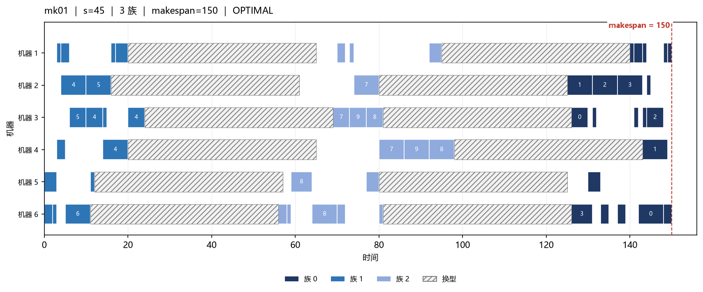
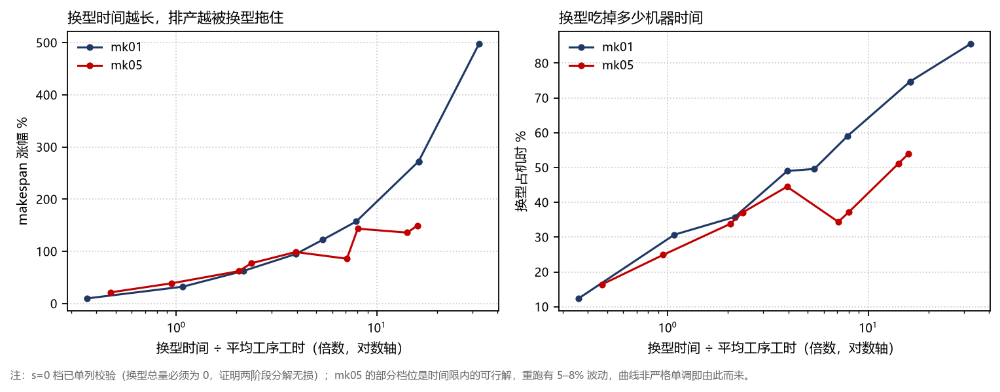

# FJSP 排产：CP-SAT 精确求解 + 换型建模

**把「派工靠老师傅经验」变成「可计算、可对比、可证明」的排产方案。**

同一批工序（Brandimarte MK01，55 道，6 台机器），把 sequence-dependent 换型加进模型后，
完工时间从 40 涨到 150；换型吃掉 74.7% 的机器时间，最忙那台 **83.3%** 的机时都在换型。



> 图上深 / 中 / 浅三色是两个工件族，灰色斜纹是被换型吃掉的机器时间。
> 「排得动」和「排得省」的差别，全在这里。

---

## 结果：10 个公开算例，8 个证明最优

| 算例 | 工件×机器 | 工序 | SPT 派工 | CP-SAT | 状态 | 相对派工 | 对最好解 | 用时 |
|---|---|--:|--:|--:|---|--:|--:|--:|
| mk01 | 10×6 | 55 | 57 | **40** | OPTIMAL | −29.8% | 0.0% | 0.1 s |
| mk02 | 10×6 | 58 | 62 | **26** | OPTIMAL | −58.1% | 0.0% | 2.5 s |
| mk03 | 15×8 | 150 | 313 | **204** | OPTIMAL | −34.8% | 0.0% | 1.1 s |
| mk04 | 15×8 | 90 | 91 | **60** | OPTIMAL | −34.1% | 0.0% | 0.5 s |
| mk05 | 15×4 | 106 | 233 | **172** | OPTIMAL | −26.2% | −0.6% | 15.3 s |
| mk06 | 10×10 | 150 | 91 | 59 | FEASIBLE | −35.2% | +1.7% | 60 s |
| mk07 | 20×5 | 100 | 204 | **139** | OPTIMAL | −31.9% | 0.0% | 23.3 s |
| mk08 | 20×10 | 225 | 648 | **523** | OPTIMAL | −19.3% | 0.0% | 0.7 s |
| mk09 | 20×10 | 240 | 443 | **307** | OPTIMAL | −30.7% | 0.0% | 10.3 s |
| mk10 | 20×15 | 240 | 386 | 219 | FEASIBLE | −43.3% | +11.2% | 60 s |

**8 / 10 达证明最优，相对 SPT 派工平均降低 34.3%**（区间 19.3%–58.1%），十例合计求解约 174 秒。
两个 60 秒内未证明最优的算例给出「对公开最好解的 gap」，不假装收敛。

> mk05 解出 172，比文献最好解 173 还小 1：本仓库使用的 jsDelivr 镜像版本与原始 Brandimarte 文件有细微差异。
> 方案已通过四项硬校验，因此在**本数据下 172 可行**——如实标注，不粉饰。

### 换型敏感性：瓶颈从「加工」变成「准备」

`s` = 跨族换型时间（同族换型为 0），两阶段分解求解：

| 算例 | 无换型 | s=15 | s=45 | s=90 |
|---|--:|--:|--:|--:|
| mk01 | 40 | 89 (+122.5%) | 149 (+272.5%) | 239 (+497.5%) |
| mk05 | 172 | 305 (+77.3%) | 320 (+86.0%) | 406 (+136.0%) |



> 左：makespan 涨幅；右：换型占总机时比例；横轴 = 换型时间 ÷ 平均工序工时（对数轴）。
> mk01 在换型时间为平均工序工时 16.2 倍时，makespan 涨 272.5%，最忙机器 83.3% 的机时用于换型。

---

## 三个必答题（面试会问的）

**① 为什么用 CP-SAT，不用遗传算法？**
GA 只能说「我搜到一个解」；CP-SAT 能给出「这个解离最优最多差 x%」——因为求解器同时维护下界。
有 gap 才能回答「值不值得再算一小时」。本仓库两个 FEASIBLE 算例就带着 gap 标注。

**② 换型为什么拆两阶段，损失多少？**
一次建模要为每对工序加 O(n²) 条弧，算例一大直接爆。所以阶段一先定机器指派、阶段二用
`AddCircuit` 排序列、弧上加换型时间。分解的代价用 `s=0` 对照实验量化：
换型总量恰为 0、makespan 与阶段一相同（40 = 40），即**分解零损失**。

**③ 公开算例没有换型数据，你这数据哪来的？**
按产品族规则构造：3 个族、同族换型 0、跨族 s，矩阵由 `src/setup_matrix.py` 生成并落盘
`data/setup_matrix_3fam_s{15,45,90}.csv`，规则写进 `data/README.md`；再对 s 与 alpha 网格做敏感性分析。
用人造数据 + 敏感性分析，好过声称「找到了真实换型数据」。

---

## 快速开始

```bash
pip install -r requirements.txt          # ortools, matplotlib（Demo 另需 streamlit）

python benchmark/run_all.py                                        # 派工基线 -> results/baseline.csv
python benchmark/run_cpsat.py --instances mk01,mk03 --limit 60      # 精确求解 -> results/cpsat.csv
python benchmark/make_summary.py                                   # 合并 -> results/summary.csv / .md
python benchmark/run_setup.py --instances mk01 --setups 0,15,45,90  # 换型实验 -> results/setup.csv
python benchmark/plot_setup.py                                     # 敏感性曲线 -> results/ + docs/
python src/plot_gantt.py data/mk01.txt --setup 45 --out docs/gantt_mk01_s45.png
python benchmark/make_report.py                                    # 技术报告 -> report/技术报告.md
streamlit run app/gantt_app.py                                     # 交互演示（需 pip install streamlit）
```

> 除最后一条外，每条命令都在本机跑通过。Streamlit Demo 只做了语法检查（环境里没装 streamlit），
> 你 `pip install streamlit` 后跑一次即可。不想装也能出图：`python src/plot_gantt.py data/mk01.txt --setup 90`。

---

## 目录结构

```
├─ data/               算例 mk01–mk10（来源 + 字节校验表 + 换型矩阵生成规则）
├─ src/                fjsp_parser / baseline / model_cpsat / setup_matrix / model_setup / plot_gantt
├─ benchmark/          run_all / run_cpsat / make_summary / run_setup / plot_setup / make_report
├─ app/gantt_app.py    Streamlit 交互演示
├─ results/            全部 csv（报告里每个数字的唯一来源）+ 敏感性曲线
├─ docs/               甘特图与曲线（README、技术报告引用的图）
├─ report/技术报告.md   由 make_report.py 从 csv 自动生成，无手写数字
├─ requirements.txt    ortools / matplotlib（Demo 另需 streamlit）
└─ LICENSE             MIT
```

`results/` 里还保留了早期调参档位（`mk10_30/60/120/300.csv`、`cpsat_mk06_300.csv`、
`setup_mk01_300.csv` 等），是「为什么最终选 60 秒预算」的过程证据，不是结论依据。

---

## 复现与校验

- **四项硬校验**：工序完备 / 机器可选且时长匹配 / 工艺顺序 / 机器互斥；
  csv 中 `verified=yes` 且 makespan 由 plan 独立复算一致，才写进报告与 README。
- `--workers 1` 完全确定；`--workers 8` 有多线程抖动：**同一设定重跑 makespan 有 3–8% 波动**
  （mk01 s=45 实测 149 与 150）。所以敏感性实验统一时间预算，只比较同批次内的相对关系。
- 已知局限：mk05 的 alpha=8 档位求解器在预处理阶段跑了 811 秒才给出可行解，远超 40 秒预算——
  大算例的 `AddCircuit` 组合模型可能在求解开始前就卡住。这也是把它拆成两阶段的原因之一。

## 数据来源

Brandimarte MK01–MK10，取自 `SchedulingLab/fjsp-instances`（jsDelivr 镜像），
逐文件字节数与镜像声明一致，校验表见 [`data/README.md`](data/README.md)。

## 许可

MIT © wangyewuqing
